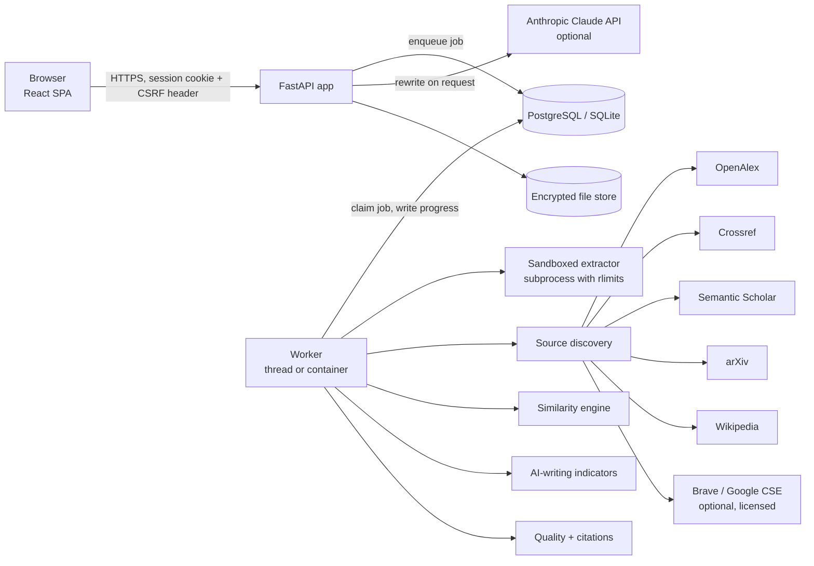
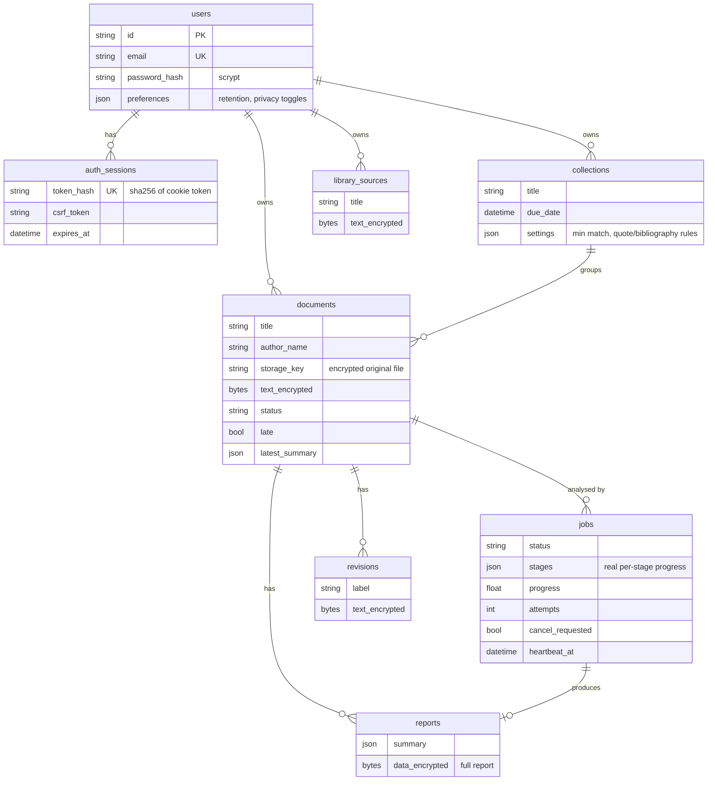

# Architecture

## Overview



One upload produces one **job**. The API returns immediately; a worker runs the
pipeline and writes stage-by-stage progress to the database, which the browser
polls. Nothing in the progress bar is simulated: each row is a real stage with
its real status, detail text and duration.

## Repository layout

```
backend/
  app/
    main.py              FastAPI app: routers, security headers, SPA hosting, embedded worker
    config.py            All settings (environment variables, see .env.example)
    db.py, models.py     SQLAlchemy engine and schema
    security.py          scrypt passwords, sessions, CSRF, rate limiting, audit log
    crypto.py            Fernet encryption at rest
    storage.py           Private file store (random keys, never user-controlled paths)
    api/                 REST routers: auth, documents/jobs/reports, assistant, workspace
    worker/              DB-backed queue, worker loop, the analysis pipeline
    services/
      extraction/        PDF/DOCX/TXT parsing in a resource-limited child process
      text.py            Normalisation and offset-preserving segmentation
      language.py        Language identification
      citations.py       In-text citations, reference list, quotes, issues
      discovery/         Query generation, providers, HTTP layer, full-text retrieval, orchestration
      similarity/        Exact/near-exact fingerprints, embeddings, semantic matching, MinHash, scoring
      aidetect/          Stylometric features, logistic model (weights.json), banded verdicts
      quality.py         Readability, clarity, concision and mechanics checks
      humanizer/         Rule-based editor, Claude-based editor, change tracking
      export.py          PDF/DOCX reports and revised documents
  eval/                  Evaluation harnesses and committed results
  tests/                 89 automated tests (unit + integration with a fake internet)
frontend/                Vite + React + TypeScript + Tailwind single-page app
Dockerfile, docker-compose.yml
```

## The analysis pipeline

| # | Stage | What happens | Module |
|---|---|---|---|
| 1 | Extract | Magic-byte type check, then parsing in a child process limited to 1 GB RAM, 60 s CPU and no file writes. Header/footer removal and de-hyphenation for PDFs. | `services/extraction` |
| 2 | Segment | Unicode normalisation; paragraphs and sentences with character offsets (abbreviation- and decimal-aware). Word limits enforced. | `services/text.py` |
| 3 | Language | Character n-gram Naive Bayes (langdetect). | `services/language.py` |
| 4 | Citations | APA/Harvard, narrative, IEEE and MLA citations; reference list; quotations; links citations to references; flags missing/uncited references, year mismatches, uncited quotes, mixed styles. | `services/citations.py` |
| 5 | Discover | Builds phrase, keyword and reference-title queries; queries every enabled provider under a budget; merges and ranks candidates; retrieves open full text (Wikipedia API, open-access PDFs, robots-permitted pages); removes mirrors with MinHash-LSH; verifies reference DOIs with Crossref. Adds the user's library and, in a collection, the other submissions. | `services/discovery` |
| 6 | Compare | Exact and near-exact matching (5-word fingerprints with gap-tolerant chaining), semantic matching (sentence embeddings + topicality filter + optional cross-encoder), attribution of each word to one source, classification, explanations and scores. | `services/similarity` |
| 7 | AI indicators | Twelve stylometric features, logistic regression, banded verdict, paragraph-level results, caveats. | `services/aidetect` |
| 8 | Quality | Readability, long sentences, passive voice, articles, spacing, confusions, wordiness, optional LanguageTool. | `services/quality.py` |
| 9 | Report | Assembles everything into one JSON report, encrypts and stores it. | `worker/pipeline.py` |

Cancellation is checked between stages and inside the long loops of stages
5 and 6. A crash is retried once; input errors (corrupt file, too long) are not
retried and are shown to the user verbatim. A worker that dies mid-job is
detected by its missing heartbeat and the job is re-queued.

## Key design decisions and trade-offs

**Python + FastAPI backend.** The NLP ecosystem (embeddings, PDF parsing,
numerical work) is in Python; FastAPI gives typed request validation and an
OpenAPI contract at `/api/docs` for free.

**Vite + React SPA instead of Next.js.** Every page sits behind sign-in, so
server-side rendering and SEO bring nothing. A static bundle served by the API
means one process to run and one origin (simpler CSRF/CSP, no CORS).

**Database-backed job queue instead of Redis/Celery.** Jobs take seconds to
minutes and volume is modest. The database already provides durability,
atomic claiming (`SELECT … FOR UPDATE SKIP LOCKED` on PostgreSQL) and the
progress record the UI reads. One fewer service to deploy and secure. The cost:
polling every second instead of push notifications, and per-instance rate
limiting (documented under Limitations).

**No pgvector.** Each analysis compares one document against at most ~50
retrieved sources. Embedding those sentences in memory and taking a matrix
product is faster and simpler than persisting vectors. pgvector would pay off
for an *institutional repository* of past submissions (millions of sentences);
the provider interface leaves room for that.

**Hybrid similarity, scored separately.** Exact/near-exact fingerprints are
precise and explainable; they define the similarity index. Semantic matching
finds paraphrase but is probabilistic, so it is reported separately and never
inflates the index. See [EVALUATION.md](EVALUATION.md) for why this split is
necessary (MRPC results).

**Pluggable embedding providers.** `sbert` (Sentence-Transformers, best),
`wordvec` (SIF-weighted spaCy vectors, works offline) and `lexical`
(TF-IDF, degraded mode that is flagged in the report). Swapping models does
not touch the matcher. The same pattern is used for search providers and for
the writing assistant (rule-based or Claude).

**Stylometric logistic regression for AI indicators.** Transparent (every
feature's contribution is shown), trainable on small data, and honest about
uncertainty through banded output. A fine-tuned neural detector would score
higher on in-distribution benchmarks but is opaque, brittle to new generators
and has documented bias against non-native writers.

**Encryption at rest for private content.** Document text, reports, revisions
and uploaded files are encrypted with Fernet. Public data fetched from the web
(search cache, fetched pages) is stored in the clear.

## Database schema



Supporting tables: `search_cache` (provider responses, 7-day TTL),
`fetch_cache` (retrieved public pages/PDF text, 30 days) and `audit_log`
(sign-ins, uploads, exports, deletions, settings changes).

## Replaceable components

| Component | Interface | Implementations |
|---|---|---|
| Search provider | `Provider.search(Query) -> [Candidate]` | OpenAlex, Crossref, Semantic Scholar, arXiv, Wikipedia, Brave, Google CSE |
| Embedding model | `EmbeddingProvider.encode(texts) -> ndarray` | Sentence-Transformers, word vectors, TF-IDF |
| Reranker | `Reranker.score(pairs)` | Sentence-Transformers cross-encoder |
| Writing assistant | `rewrite(text, mode) -> changes` | Rule-based editor, Anthropic Claude |
| Grammar engine | merged findings | built-in rules, LanguageTool server |
| Database | SQLAlchemy URL | SQLite (local), PostgreSQL (production) |
